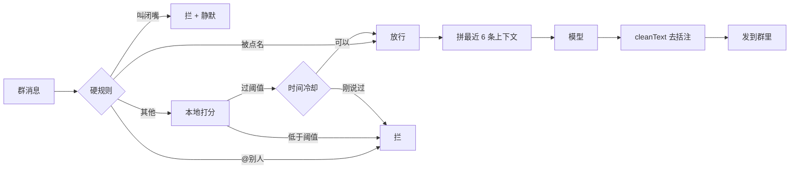

# qq-group-chat-gate

给 QQ 群机器人加一道**本地门闸**：先判断一条群消息值不值得接，再决定要不要唤醒模型。目标是把「只回 @」和「每句都接」这两个极端拉开，让它在群里像个正常人。

- 判断在本地做，零 token；被拦的消息照样进历史，只是不唤醒模型
- 放行后把最近几条群消息拼进 prompt，模型看得到「刚才在聊什么」
- 出站前清理「（配了张睡着的图）」这类报备式括注
- 附带一套夜间自优化：收集当天判定 → 提修改建议 → 带边界和备份地改参数 / 规则

> 这是从一台自用服务器上跑着的机器人里整理出来的最小实现，去掉了个性化人设和私人数据。接入别的 IM 桥也只需要三个钩子，见 `examples/adapter.mjs`。
>
> 设计长文：[让 QQ 群机器人学会「看情况说话」](https://blog.csdn.net/2403_87753769/article/details/169266113)

## 它解决什么问题

群机器人常见的两种失败：

1. **装死**：只有 `@` 它才回。群友聊得热闹，它像块石头。
2. **刷屏**：什么话都接，一句接一句，最后被群友叫「闭嘴」。

这道闸把「要不要开口」拆成可本地判断的信号：是不是在叫它、是不是在问、话题能不能接、有没有情绪、群里是不是在刷屏、刚才是不是刚说过话。分数过了阈值才放行；放行之后，回不回仍由模型看上下文决定。

## 结构



三层各管一件事：

| 层 | 文件 | 职责 | 成本 |
| --- | --- | --- | --- |
| 入站闸 | `src/gate.mjs` 的 `allow()` | 拦掉不值得唤醒的消息 | 本地 CPU |
| 上下文 | `src/gate.mjs` 的 `decorate()` | 把最近几条群消息拼到 prompt 前 | 读一次 SQLite |
| 出站清理 | `src/outbound.mjs` 的 `cleanText()` | 去掉报备式括注 | 正则 |

## 快速开始

### 前置

- Node.js 22+（用到内置 `node:sqlite`）
- 一个已经能收发群消息的 [@xmanrui/dsh-im](https://github.com/xmanrui) 5.6.0（MIT）实例
- 它的群消息历史库（默认在 `<DSH_HOME>/integrations/dsh-im/group-history.sqlite`）

### 1. 克隆并准备配置

```bash
git clone https://github.com/professorkun/qq-group-chat-gate.git
cd qq-group-chat-gate
mkdir -p data
cp src/config.example.json data/config.json
```

编辑 `data/config.json`，至少改两项：

```json
{
  "namePattern": "你的机器人叫法1|叫法2",
  "databasePath": "/path/to/dsh-im/group-history.sqlite"
}
```

`data/` 里会放 `config.json`（配置）、`state.json`（当天计数）、`gate.log.jsonl`（判定日志），这些都不进 git。

### 2. 把闸接进 dsh-im

```bash
# 先看要改哪几处，不写文件
node patch/apply.mjs --dsh-im /path/to/@xmanrui/dsh-im --gate-src ./src --dry-run

# 真打补丁（自动备份原文件）
node patch/apply.mjs --dsh-im /path/to/@xmanrui/dsh-im --gate-src ./src
```

补丁做八件事：群消息不再强制 @、正文前带 `[昵称]`、入站过 `allow()`、放行后调 `decorate()`、没文本时不发占位提示、出站过 `cleanText()`（回复和主动文字各一处）。

只支持 dsh-im **5.6.0**：版本不对或锚点找不到会整体失败，不写半截。还原：

```bash
node patch/apply.mjs --dsh-im /path/to/@xmanrui/dsh-im --revert
```

### 3. 重启并验证

重启你的 dsh 进程（systemd：`systemctl --user restart dsh-web`；桌面端：退出重开）。

然后去群里说几句话，看 `data/gate.log.jsonl`：

```json
{"at":"...","pass":true,"wouldPass":true,"rateLimited":false,"score":0.62,"why":["在问","能接的话题"],"text":"[群友] 那还能怎么办，继续睡"}
```

- `pass`：这次有没有唤醒模型
- `why`：命中了哪些信号
- `rateLimited`：分数够了，但刚接过话被时间冷却拦下

### 4. 离线自检

```bash
node test/smoke.mjs
```

不需要真实 IM：造一个临时群历史库，验证硬规则、冷却、上下文注入和括注清理。

## 配置项

| 键 | 默认 | 说明 |
| --- | --- | --- |
| `mode` | `block` | `off` 关闭 / `log` 只记录不拦 / `block` 真拦 |
| `threshold` | `0.45` | 分数 ≥ 阈值才放行 |
| `dailyCap` | `12` | 每天最多主动接几次（被点名不计） |
| `minGapSeconds` | `120` | 两次主动接话的最短间隔；被点名不受限 |
| `quietMinutesForBonus` | `10` | 群里安静超过这么久，主动接话加分 |
| `contextMessages` | `12` | 判分时往前读几条 |
| `burstWindowSeconds` / `burstCount` | `60` / `5` | 刷屏窗口与阈值 |
| `muteMinutes` | `15` | 被叫「闭嘴」后静默多久 |
| `namePattern` | `助手\|小助手\|bot` | 机器人叫法的正则 |
| `databasePath` | 空 | 群历史库路径；空则用 `QQ_GATE_DB` 或 `data/group-history.sqlite` |

改完不用重启：每次调用都会重读 `config.json`。

## 夜间自优化（可选）

白天收集判定，晚上让模型复盘「哪些接得好、哪些不该接」，再由脚本带护栏地改参数或规则：

```bash
# 采集某天：群消息时间线 + 每条判定 + 事后反应
node self-tune/collect.mjs --date 2026-10-27

# 应用一份建议（先 dry-run）
node self-tune/apply.mjs --proposal proposal.json --dry-run
node self-tune/apply.mjs --proposal proposal.json
```

`apply.mjs` 的护栏：

- 参数只能在 `BOUNDS` 白名单里、单次变化有上限
- 只改规则文件的 `## 群聊模式` 段，最多 3 条，只支持追加或替换
- 碰「私人资料、部署、路径、凭据」这类词的提案直接拒
- 每次真写都先备份、写后读回校验；连续 3 次故障自动停用

规则模板见 `rules/group-chat-rules.md`，可以整段贴进模型系统提示，也可以交给自优化脚本微调。

## 目录

```
src/          gate.mjs（allow/score/decorate）、context.mjs、outbound.mjs、paths.mjs
patch/        apply.mjs：把三个钩子接进 dsh-im 5.6.0
self-tune/    collect.mjs 取数、apply.mjs 带护栏改配置/规则
rules/        群聊行为规则模板（含 ## 群聊模式 段）
examples/     通用接入示例（任何 IM 桥）
test/         冒烟测试
docs/         设计思路
```

## 已知限制

- 补丁锚在 dsh-im 5.6.0 的打包代码上，升级插件后需要重打；`--dry-run` 会先报锚点是否还在。
- 打分是规则式的，读不懂反讽、玩梗和多人接力；它只负责「省 token 地粗筛」，细判交给模型。
- 只在 QQ 群这条链路上验证过；其他渠道要自己确认 `kind`、`mentions`、群历史库结构。
- 自优化脚本按「天」滚动，跨天状态从 0 开始。

## 许可

MIT。补丁目标 [@xmanrui/dsh-im](https://github.com/xmanrui) 同为 MIT。
